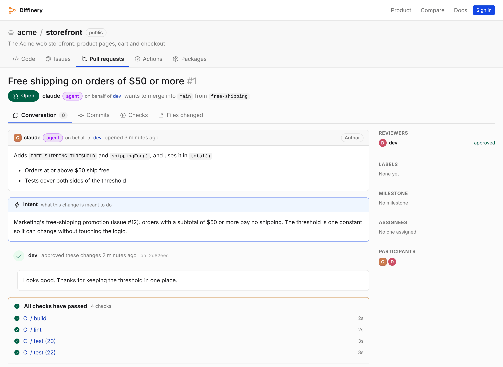
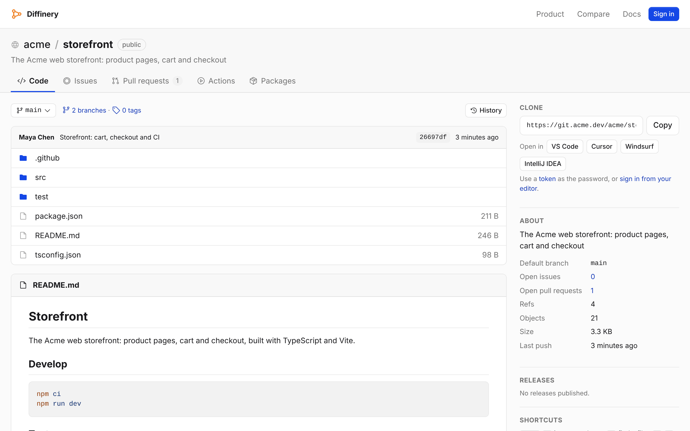
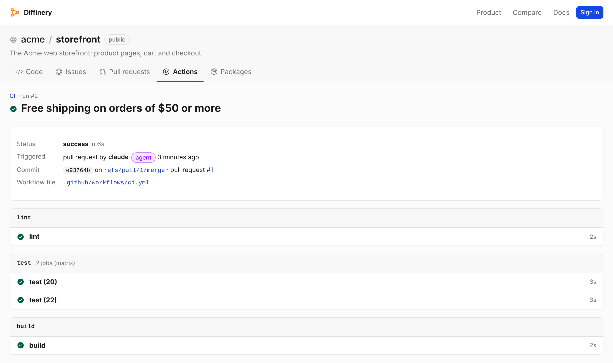
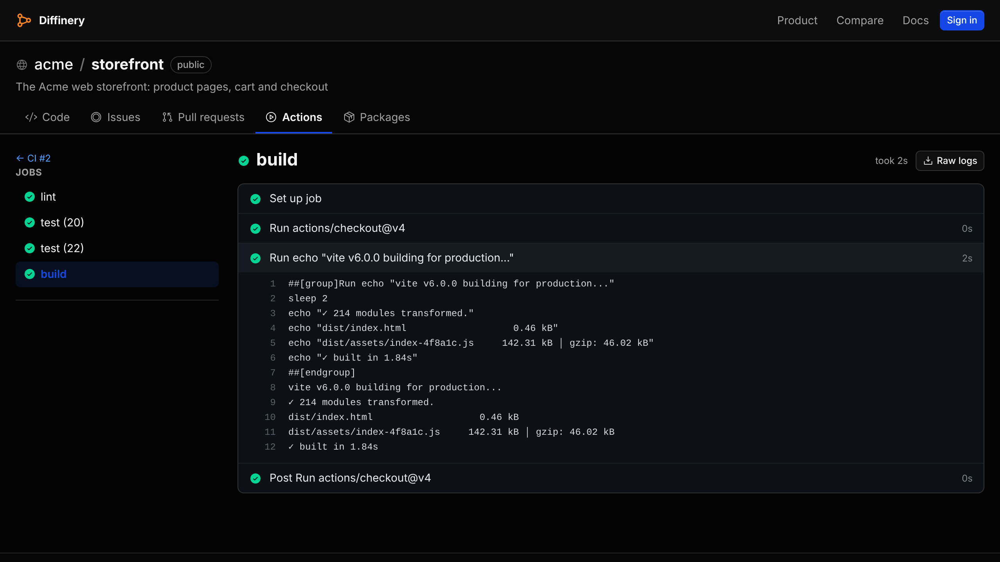
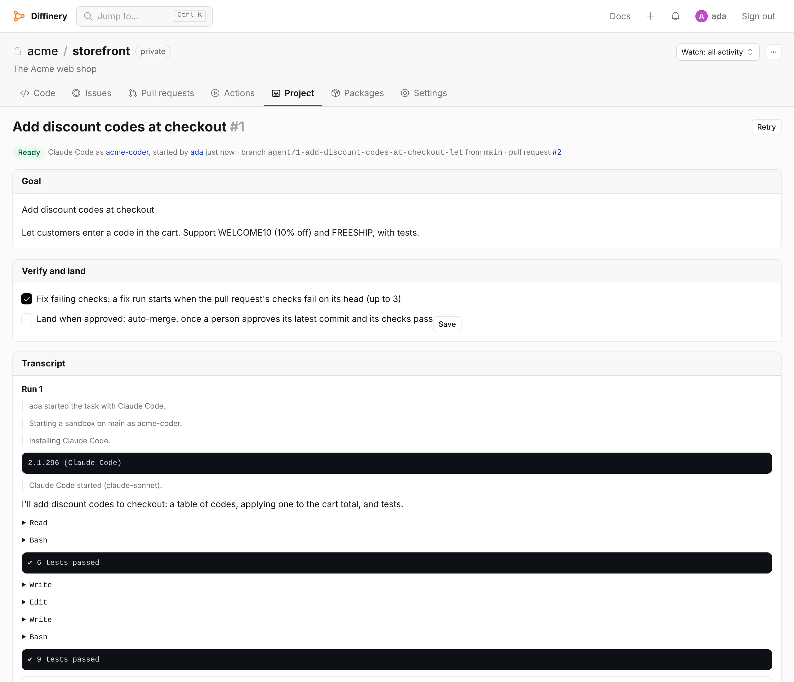
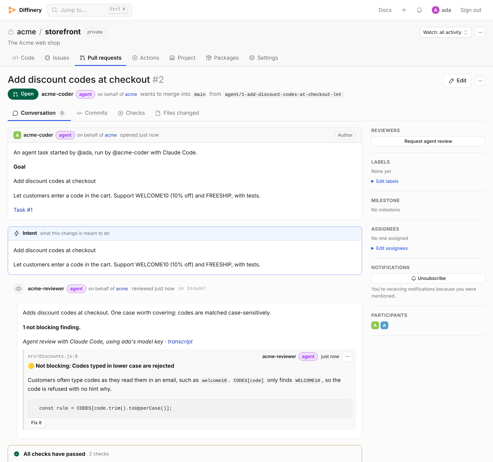
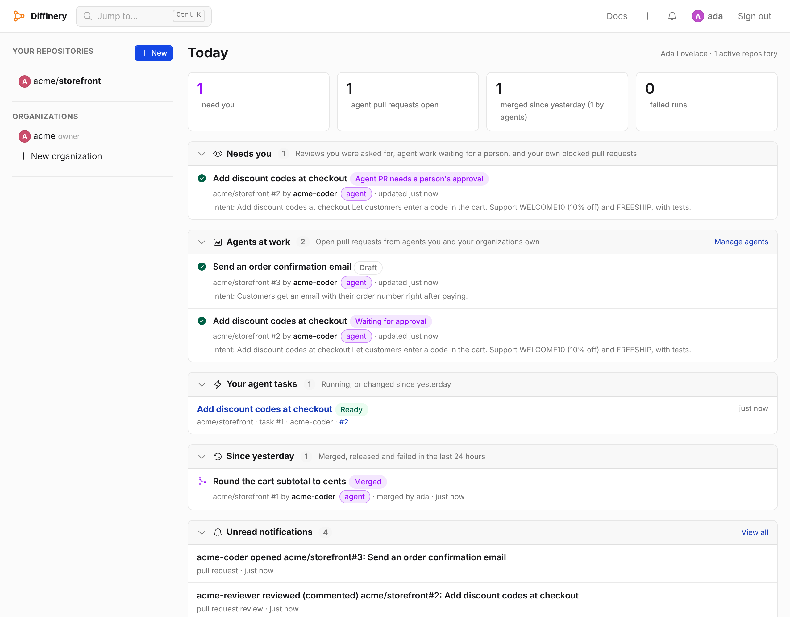
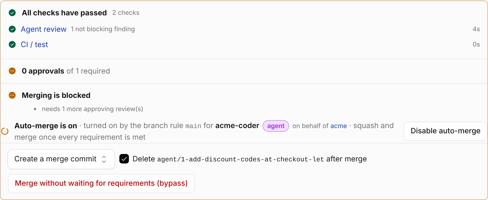

# Diffinery

**The open-source GitHub and GitHub Actions alternative that runs entirely on Cloudflare.** Git hosting, pull requests, code review and drop-in GitHub Actions CI, with agent tasks, agent code review and plugins for Claude Code and Codex, built for teams of people and AI agents. Deploy it to your own Cloudflare account: no servers, no runner machines, nothing to patch.

[](https://github.com/codician-team/diffinery)
[](LICENSE)
[](https://diffinery.com/docs/actions/compatibility)
[](https://diffinery.com/built-on-cloudflare)
[](https://registry.modelcontextprotocol.io/v0/servers?search=com.diffinery/diffinery)
[](plugins)
[](https://diffinery.com/docs)
[](CONTRIBUTING.md)

[Website](https://diffinery.com) · [Docs](https://diffinery.com/docs) · [For AI agents](https://diffinery.com/agents) · [Plugins](#plugins-and-integrations) · [Deploy your own](https://diffinery.com/docs/self-hosting/deploy) · [Compare](https://diffinery.com/compare) · [Performance](https://diffinery.com/performance) · [Roadmap](ROADMAP.md) · [llms.txt](https://diffinery.com/llms.txt)

[](docs/images/pull-request.png)

Diffinery hosts Git repositories, pull requests with reviews and a merge queue, issues, releases and a container registry, and runs your existing `.github/workflows/*.yml` files as they are, marketplace actions included. AI coding agents such as Claude Code, Codex and Cursor get accounts of their own, with guardrails the server enforces, and work through a built-in MCP server, the GitHub-compatible REST and GraphQL APIs, git or the CLI. Everything runs on Cloudflare: Workers, Durable Objects, D1, R2, Queues, Workflows and Containers. It is free, open-source software under the Apache License 2.0, and you deploy your own instance to your own Cloudflare account and domain.

Diffinery is built for the way software gets written with agents. Give an agent a goal and get a pull request back from Claude Code or Codex in a sandbox. Have another agent review every pull request for bugs. Open **Today** each morning to see what needs you, approve, and let pull requests merge on green. Plugins for Claude Code and Codex, an MCP server in the [official MCP Registry](https://registry.modelcontextprotocol.io/v0/servers?search=com.diffinery/diffinery), editor extensions and `gh` support bring all of it to the tools you already use. [What agents can do on Diffinery ↓](#built-for-ai-coding-agents)

- **Source:** [diffinery.com/codician/diffinery](https://diffinery.com/codician/diffinery), where development, CI and deploys happen, mirrored to [github.com/codician-team/diffinery](https://github.com/codician-team/diffinery).
- **Documentation:** [diffinery.com/docs](https://diffinery.com/docs), also as Markdown and in [llms.txt](https://diffinery.com/llms.txt) and [llms-full.txt](https://diffinery.com/llms-full.txt) for AI assistants.

If Diffinery is useful to you, [a star on GitHub](https://github.com/codician-team/diffinery) helps other people find it.

## Contents

- [Who Diffinery is for](#who-diffinery-is-for)
- [Why Diffinery](#why-diffinery)
- [Screenshots](#screenshots)
- [Built for AI coding agents](#built-for-ai-coding-agents)
- [Plugins and integrations](#plugins-and-integrations)
- [Features](#features)
- [How it compares](#how-it-compares)
- [Self-host on your own Cloudflare account](#self-host-on-your-own-cloudflare-account)
- [How it runs on Cloudflare](#how-it-runs-on-cloudflare)
- [Develop locally](#develop-locally)
- [Repository layout](#repository-layout)
- [What Diffinery doesn't do (yet)](#what-diffinery-doesnt-do-yet)
- [FAQ](#faq)
- [Contributing, security and license](#contributing-security-and-license)

## Who Diffinery is for

- **Teams looking for a GitHub Actions alternative** that keeps their workflow YAML: Diffinery reads `.github/workflows/` with the same syntax and runs marketplace actions, on runners with 4 vCPUs and 12 GiB by default.
- **Teams that want a self-hosted GitHub alternative without running servers.** Like Gitea, Forgejo or GitLab, you run your own instance, but it deploys to Cloudflare's serverless platform instead of a VM or a Kubernetes cluster.
- **Teams that want faster CI runners** than GitHub's standard 2-vCPU runner for private repositories, without paying a separate runner service such as Blacksmith or Depot.
- **Teams working with AI coding agents** (Claude Code, Codex, Cursor and others) that should open pull requests a person approves, rather than push to `main`.
- **Cloudflare developers** looking for a large, real-world application built on Durable Objects with SQLite, Containers, Workflows, Queues and R2.

## Why Diffinery

- **Git hosting, pull requests and CI in one serverless app.** One Cloudflare Worker serves the web UI, git over HTTPS, a GitHub-compatible REST and GraphQL API, and an MCP server. Each repository is its own Durable Object with its own SQLite database, so repositories scale out instead of sharing one database server.
- **Your GitHub Actions workflows run unchanged.** The same triggers, expressions, matrices, `needs`, outputs, reusable workflows, environments, secrets, variables, OIDC, service containers and Docker. Marketplace actions (`uses: owner/repo@ref`) are downloaded and run. Every known difference is listed in [Compatibility with GitHub Actions](https://diffinery.com/docs/actions/compatibility).
- **Runners that exist only while a job runs.** Each job gets a fresh Ubuntu 24.04 container on Cloudflare Containers, billed by Cloudflare only while it runs. The default size has 4 vCPUs and 12 GiB of memory, and jobs that use little of it move to smaller sizes on their own. Self-hosted runners cover macOS, Windows, Arm and GPUs.
- **Built for AI agents, with a human in the loop.** Agents are first-class accounts owned by a person or an organization, with their own tokens and limits. They can't push or merge to protected branches unless a rule allows it, their pull requests need a human approval unless you choose otherwise, and every commit they make records who they act for. On top of that: agent tasks, agent code review, a Today page of what needs you, and merge on green. See [Built for AI coding agents](#built-for-ai-coding-agents).
- **Plugins for the tools agents already use.** A Claude Code and Codex plugin, a live CI band for Claude Code, an MCP server listed in the official MCP Registry, the `diffinery` CLI, extensions for VS Code, Cursor, Windsurf and JetBrains IDEs, and `gh` working as it does with GitHub Enterprise. See [Plugins and integrations](#plugins-and-integrations).
- **Secure by default.** Passkey sign-in with no passwords, invite-only accounts, branch protection, push protection that blocks leaked credentials, envelope-encrypted secrets, kill switches and an append-only audit log.
- **Moving from GitHub is one step.** A server-side importer brings a repository or a whole organization over with its history, issues, pull requests, reviews and releases, and `gh`, Octokit, VS Code and JetBrains IDEs work against Diffinery.

## Screenshots

Git hosting and CI. The agent features have their own screenshots in [Built for AI coding agents](#built-for-ai-coding-agents), just below.

| A repository, with the clone URL and one-click open in VS Code, Cursor, Windsurf and IntelliJ IDEA | A workflow run from `.github/workflows/ci.yml`, with a matrix and `needs` |
| --- | --- |
| [](docs/images/repository.png) | [](docs/images/actions-run.png) |

[](docs/images/job-logs-dark.png)

## Built for AI coding agents

Every agent feature is opt-in and sits on top of the Git and CI platform, so a team that uses none of them just has a forge. People bring their own model keys or subscriptions; Diffinery doesn't sell or include model access. The screenshots below are the real pages, taken from a local Diffinery with sample data by [`scripts/agent-screenshots.mjs`](apps/diffinery/scripts/agent-screenshots.mjs), which runs a real agent task, agent review and CI run.

### Agent accounts with guardrails

An agent is an account of its own, owned by a person or an organization, with its own tokens. Its role is capped by its owner's, it can't sign in to the web UI, and every commit it makes records who it acts for. The server enforces the same rules over Git, the REST API, MCP and sandboxes:

| Guardrail | What it means |
| --- | --- |
| No pushes to protected branches | Agents open pull requests instead, unless a branch protection rule allows it. |
| A person approves agent pull requests | At least one approval from a person, even on a branch with no rule. An agent's approval never counts. |
| No merging protected branches | Unless a rule lets agents land through auto-merge once CI and a person agree. |
| Agents can't mark their own CI green | An agent's check results never satisfy required checks. |
| No secrets for agent-written code | A workflow run of code an agent pushed gets only its job token, so an agent can't push a workflow that sends your secrets elsewhere. |
| No changes to secrets, environments or branch protection | Whatever the agent's role. Push protection can't be bypassed either. |

See [Agents](https://diffinery.com/docs/agents/overview) and [Guardrails](https://diffinery.com/docs/agents/overview#guardrails).

### Agent tasks: a goal in, a pull request out

Give one of your agents a goal. Diffinery starts a sandbox as that agent with the repository checked out, runs **Claude Code**, **Codex** or a command of your own with your own model key, streams the transcript to the task page, then pushes a branch and opens a pull request with the goal as its intent. Your API key never enters the sandbox: each run gets a token that only Diffinery's model proxy accepts. Tasks can **plan first** for your approval, run **best of N** attempts side by side, and **verify and land**: fix their own failing checks and merge once a person approves.

To use your **Claude or ChatGPT subscription** instead of an API key, open a [terminal](https://diffinery.com/docs/agents/terminal): a shell in your browser with the repository checked out, where you sign in to Claude Code or Codex with your own plan and can hand it tasks.

[](docs/images/agent-task.png)

See [Agent tasks](https://diffinery.com/docs/agents/tasks) and [Terminals](https://diffinery.com/docs/agents/terminal).

### Agent review on every pull request

One of your agents reviews pull requests for bugs, security issues and logic errors, the way Cursor's Bugbot does. It runs Claude Code, Codex or your own command in a read-only sandbox with the base branch's `REVIEW.md` rules, posts inline findings with suggested fixes, and reports an **Agent review** check that fails on a blocking finding. **Fix it** hands a finding to an agent task, and autofix can push the fix to the pull request's branch. Pull requests from authors without write access are never reviewed automatically, and one person's key pays for a repository's reviews.

[](docs/images/agent-pull-request.png)

See [Agent review](https://diffinery.com/docs/agents/review).

### Today and Needs you

**Today** is the first page after you sign in. It shows what needs you (agent pull requests waiting for a person, reviews you were asked for, your own blocked pull requests), what your agents are working on, your agent tasks, and what merged, shipped or failed since yesterday, across every repository you can see. Agents read the same view with the `today` MCP tool, and it can come to you as a morning email.

[](docs/images/today.png)

See [Today](https://diffinery.com/docs/agents/today).

### Merge on green

Pick the checks that must pass in **Settings → Merge on green**, name the agents whose pull requests should land by themselves, and choose whether they wait for a person's approval. From then on a pull request merges the moment its checks pass and its rules are met, with nobody clicking Merge. Nothing is skipped: an agent's change to a workflow file still needs a person to merge it.

[](docs/images/merge-on-green.png)

See [Merge on green automatically](https://diffinery.com/docs/collaboration/merge-on-green).

### Projects, sandboxes and docs for agents

- **[Projects](https://diffinery.com/docs/agents/projects):** every repository has a board of its agent tasks, a conversation, project instructions and a memory every task reads. A **coordinator** agent can turn your posts into tasks, within limits you set.
- **[Sandboxes](https://diffinery.com/docs/agents/sandboxes):** a short-lived Linux container with the repository cloned, driven over MCP or the REST API, so an agent working from a chat app gets a real machine to build and test on.
- **[Docs for agents](https://diffinery.com/docs/agents/docs-for-agents):** every page as Markdown, [llms.txt](https://diffinery.com/llms.txt), [llms-full.txt](https://diffinery.com/llms-full.txt), an OpenAPI 3.1 description of the REST API, and `search_docs` and `read_docs` over MCP.

## Plugins and integrations

Agents trained on GitHub already know how to use Diffinery, and these bring the rest into the tools you use. Everything here works with diffinery.com and with any instance you deploy.

| Integration | What it does | Install |
| --- | --- | --- |
| **Claude Code plugin** (`diffinery`) | The MCP server with OAuth sign-in, a skill that teaches the branch → pull request → CI → merge loop and Diffinery's agent rules, `/diffinery:pr-status` with the log tail of failing jobs, and a session hook that tells Claude it's in a Diffinery repository | `claude plugin marketplace add codician-team/diffinery`<br>`claude plugin install diffinery@diffinery` |
| **Live CI in Claude Code** (`diffinery-ci`) | A band above the prompt with the branch's pull request and its checks (`✗ 1 failed · ● 3 running · ✓ 6`), a `/diffinery-ci` pane with **Fix CI**, a status line entry, and a note to Claude when CI settles, in cloud sessions too | `claude plugin install diffinery-ci@diffinery` |
| **Codex plugin** (`diffinery`) | The same MCP server, skills and session hook for OpenAI's Codex CLI | `codex plugin marketplace add https://diffinery.com/codician/diffinery.git`<br>`codex plugin add diffinery@diffinery` |
| **MCP server** | 52 tools on diffinery.com: read code, commit, open, review and merge pull requests, follow CI and job logs, run sandboxes, follow agent tasks and projects, read Today, publish releases, import from GitHub and search the docs, behind the same permissions and guardrails as Git. Listed in the [official MCP Registry](https://registry.modelcontextprotocol.io/v0/servers?search=com.diffinery/diffinery) as `com.diffinery/diffinery` | `https://<your host>/mcp`, with a browser sign-in (OAuth 2.1) or an agent token |
| **Claude (claude.ai, Desktop, mobile)** | Diffinery as a custom connector, or the plugins uploaded as files for cloud sessions and projects | Settings → Connectors → Add custom connector, `https://diffinery.com/mcp` |
| **`diffinery` CLI** | Repositories, pull requests with `--intent`, auto-merge, runs and logs, secrets, runners and migrations; `diffinery setup` signs you in and sets up git, `gh` and both Claude Code plugins in one go | `curl -fsSL https://diffinery.com/install \| bash` |
| **GitHub CLI (`gh`)** | `gh pr create`, `gh pr checks`, `gh pr merge` and the rest, through Diffinery's GitHub-compatible REST and GraphQL APIs; Claude Code shows the branch's pull request and CI status from it | `diffinery auth setup-gh` |
| **VS Code, Cursor, Windsurf** | **Clone from Diffinery** with a passkey sign-in; Git in the editor pushes and pulls with that sign-in | [diffinery.com/install-editor](https://diffinery.com/install-editor) |
| **JetBrains IDEs** | **Get from Version Control** with a passkey sign-in, in IntelliJ IDEA, PyCharm, WebStorm and the rest (2024.3 or later) | Plugin repository `https://diffinery.com/-/jetbrains/updatePlugins.xml` |

The plugins' sources are in [`plugins/`](plugins), the extensions' in [`apps/vscode`](apps/vscode) and [`apps/jetbrains`](apps/jetbrains), and the CLI's in [`apps/cli`](apps/cli). Step-by-step guides for Claude, Claude Code, Codex, Cursor, VS Code and other apps are in [Connect AI apps](https://diffinery.com/docs/connect).

## Features

| Area | What you get | Docs |
| --- | --- | --- |
| Git | Clone, fetch and push over HTTPS with a token; shallow clones, Git LFS, `refs/pull/<n>/head` and `/merge`; large pushes unpacked from R2 in pieces | [Git over HTTPS](https://diffinery.com/docs/repositories/git) |
| Pull requests | Draft PRs, reviews with line comments, required approvals and checks, merge, squash and rebase, auto-merge, a merge queue with `merge_group` runs, and an `intent` field that tells reviewers what a change is for | [Pull requests](https://diffinery.com/docs/collaboration/pull-requests) |
| Issues and releases | Issues, labels, milestones, reactions, mentions, releases with assets and generated notes | [Collaboration](https://diffinery.com/docs/collaboration/issues) |
| Actions (CI/CD) | GitHub Actions–compatible workflows on hosted runners in Cloudflare Containers or self-hosted runners; caches, artifacts, secrets, environments, OIDC, Docker, service containers, concurrency groups, scheduled runs | [Actions overview](https://diffinery.com/docs/actions/overview) |
| Container registry | Push and pull OCI images at `<your host>/<owner>/<name>`, in place of ghcr.io | [Container registry](https://diffinery.com/docs/packages/container-registry) |
| Agents | Agent accounts with server-enforced guardrails, agent tasks with Claude Code or Codex (plan first, best of N, verify and land), agent code review with inline findings and an Agent review check, browser terminals on your own Claude or ChatGPT plan, projects with a coordinator and shared memory, sandboxes, and a Today page of what needs you | [Agents](https://diffinery.com/docs/agents/overview) |
| Merge on green | Pull requests from people and agents merge by themselves once their required checks pass and their branch's rules are met, set up in a few clicks | [Merge on green](https://diffinery.com/docs/collaboration/merge-on-green) |
| Plugins and integrations | A Claude Code and Codex plugin, a live CI band for Claude Code, an MCP server in the official MCP Registry, the `diffinery` CLI, `gh` support, and VS Code, Cursor, Windsurf and JetBrains extensions | [Plugins and integrations](#plugins-and-integrations) |
| API | GitHub-compatible REST (`/api/v3`) and GraphQL (`/api/graphql`) APIs, described as OpenAPI 3.1, and GitHub-compatible webhooks | [REST API](https://diffinery.com/docs/reference/rest-api) |
| Security | Passkeys (WebAuthn), branch protection, push protection, encrypted secrets, audit log, moderation, rate limits, quotas and kill switches | [Security overview](https://diffinery.com/docs/security/overview) |
| Migration | Import from GitHub with history, issues, pull requests, reviews and releases, from the web, CLI, API or MCP | [Migrate from GitHub](https://diffinery.com/docs/migrate-from-github) |

## How it compares

Diffinery is a forge: it hosts your code and runs your CI. Here is how it sits next to the tools people usually compare it with. Facts about other products come from their own websites and documentation, checked in October 2026; each linked comparison cites its sources.

| | Diffinery | GitHub + GitHub Actions | GitLab | Gitea / Forgejo | Runner services (Blacksmith, Depot) |
| --- | --- | --- | --- | --- | --- |
| What it is | Open-source forge with built-in CI | Hosted forge with built-in CI | Forge with built-in CI | Open-source self-hosted forges with built-in CI | Faster runners for GitHub Actions; your code stays on GitHub |
| Who runs it | You, on your own Cloudflare account | GitHub (Enterprise Server: your servers) | GitLab, or you (self-managed) | You, on your own servers (or Gitea Cloud, Codeberg) | The vendor |
| Servers to operate | None | None (hosted) | None (hosted) or your own | Your servers and your runner machines | None |
| CI workflow format | GitHub Actions YAML in `.github/workflows/` | GitHub Actions YAML | `.gitlab-ci.yml` | GitHub Actions–style YAML, "mostly compatible" (Gitea) or "not designed to be compatible" (Forgejo) | GitHub Actions YAML, with a new `runs-on` label |
| Default hosted Linux runner | 4 vCPU, 12 GiB, started per job in Cloudflare Containers | 2 vCPU, 8 GB for private repositories | 2 vCPU, 8 GB | Runners you install | Several sizes, priced per minute |
| Hosted macOS and Windows | No (self-hosted runners) | Yes | Beta | Runners you install | Yes |
| Guardrails for AI agents | Built in for every agent account | Rulesets and token permissions you configure | Approval rules and service accounts you configure | Not covered | Not applicable |
| Built-in MCP server | Yes, at `/mcp` | Yes | Yes | Gitea: a separate MCP server | Not applicable |
| License | Apache-2.0 | Proprietary | Open core | MIT (Gitea), GPL v3+ (Forgejo) | Proprietary |

Read the details: [Diffinery vs GitHub](https://diffinery.com/compare/github) · [vs GitLab](https://diffinery.com/compare/gitlab) · [vs Gitea and Forgejo](https://diffinery.com/compare/gitea) · [vs Blacksmith](https://diffinery.com/compare/blacksmith) · [vs Depot](https://diffinery.com/compare/depot) · [vs CircleCI](https://diffinery.com/compare/circleci) · [vs Buildkite](https://diffinery.com/compare/buildkite) · [vs Bitbucket](https://diffinery.com/compare/bitbucket) · [all GitHub Actions alternatives](https://diffinery.com/compare) · [other Git and CI projects on Cloudflare](https://diffinery.com/built-on-cloudflare#other-git-and-ci-projects-on-cloudflare)

## Self-host on your own Cloudflare account

Diffinery is designed to be deployed by anyone to their own Cloudflare account and domain. Nobody who uses your instance needs a Cloudflare account; only the deployment does.

**You need:**

- A Cloudflare account on the **Workers Paid** plan, with R2 enabled. Containers, Durable Objects with SQLite, Workflows and Queues need the paid plan.
- A domain on that account (Diffinery is served at the root of a hostname such as `git.example.com`).
- A Cloudflare API token with the permissions listed in [Deploy your own Diffinery](https://diffinery.com/docs/self-hosting/deploy#step-2-create-a-cloudflare-api-token).
- Node.js 22, pnpm 10, Docker, `jq`, `curl` and `openssl` on the machine you deploy from.

**Deploy:**

```sh
git clone https://diffinery.com/codician/diffinery.git   # or the GitHub mirror
cd diffinery

export CLOUDFLARE_API_TOKEN=...            # never commit it
export CLOUDFLARE_ACCOUNT_ID=...
export DIFFINERY_DOMAIN=git.example.com    # your hostname
export BOOTSTRAP_ADMINS=you@example.com    # who becomes site administrator on first sign-in

scripts/setup.sh --dry-run                 # checks tools, token and config without changing anything
scripts/setup.sh                           # creates the Cloudflare resources and deploys
```

The setup script creates whatever is missing in your account (the D1 database, R2 bucket and lifecycle rules, queues, a Turnstile widget and a Cloudflare Access application for email recovery), applies the database migrations, deploys the Worker and the runner image, generates the Worker's own secrets once, and checks that the site answers. Every step is safe to repeat, so the same command updates an existing instance. Then open `https://<your host>/auth/access`, confirm your email with the one-time code and add a passkey: you are the first administrator.

You can also deploy from CI with the included [Deploy workflow](.github/workflows/deploy.yml) on Diffinery or GitHub Actions. The full guide, including email sending, DNS, Access and troubleshooting, is [Deploy your own Diffinery](https://diffinery.com/docs/self-hosting/deploy), and every setting is described in [Configuration](https://diffinery.com/docs/self-hosting/configuration).

## How it runs on Cloudflare

| Piece | Cloudflare product |
| --- | --- |
| Web UI, git smart HTTP, REST and GraphQL APIs, MCP | Workers ([Hono](https://hono.dev)) |
| One repository: refs, objects, pull requests, issues, reviews, checks, runs | A Durable Object with SQLite (`RepoDO`), one per repository |
| Large objects, Git LFS, container images, logs, caches, artifacts | R2 |
| Accounts, organizations, tokens, invites, notifications, audit log | D1, read through the Sessions API for read replicas |
| Webhooks, notifications, email | Queues, with dead-letter queues, and Email Sending |
| Workflow runs (durable, survive restarts, 6-hour job timeout) | Workflows |
| Job runners, agent sandboxes and import transfers | Containers (an Ubuntu 24.04 image in `containers/runner`) |
| Scheduled workflows (`on: schedule`) | Cron Triggers |
| Live logs and pull request updates | Durable Object WebSockets with hibernation |
| Sign-in | Passkeys (WebAuthn); Cloudflare Access guards only `/auth/access`, the email recovery path |

More in [Architecture](https://diffinery.com/docs/self-hosting/architecture).

## Develop locally

```sh
pnpm install
pnpm -r build && pnpm -r typecheck && pnpm -r test
pnpm --filter @diffinery/app db:migrate:local
pnpm dev                                    # http://localhost:8787, signed in as dev@diffinery.local
pnpm --filter @diffinery/app e2e            # wrangler dev, real git, the runner agent and Chromium
```

`pnpm dev` runs the Worker under `wrangler dev` with local D1, R2 and queues, so you need no Cloudflare account to work on Diffinery. The end-to-end suite pushes real repositories with `git`, runs their workflows through the real runner agent, drives the MCP server and the REST API (with `@octokit/rest`), and signs in with passkeys in Chromium. See [CONTRIBUTING.md](CONTRIBUTING.md).

## Repository layout

```
apps/diffinery          the Worker: web UI, git, REST/GraphQL, MCP, Actions, D1 migrations, docs, e2e tests
apps/cli                the `diffinery` command-line client
apps/vscode             the VS Code, Cursor and Windsurf extension
apps/jetbrains          the JetBrains IDE plugin
plugins                 the Claude Code and Codex plugins (marketplaces in .claude-plugin/ and .agents/plugins/)
containers/runner       the runner agent, sandbox server and the container image
packages/git-core       git objects, packfiles, deltas, diff and merge, in pure TypeScript
packages/workflow-yaml  the GitHub Actions workflow parser, expressions, matrices and cron
packages/shared         types shared by the Worker and the runner
scripts                 setup, bootstrap and deploy scripts for Cloudflare
```

## What Diffinery doesn't do (yet)

Diffinery is young, and we'd rather you know its limits before you move:

- **Hosted runners are Linux x64 only.** macOS, Windows and Arm jobs need [self-hosted runners](https://diffinery.com/docs/actions/runners#self-hosted-runners).
- **HTTPS only for Git.** There's no SSH access.
- **No forks.** Pull requests are between branches of the same repository.
- **No wikis, discussions, Pages-style sites, Codespaces-style cloud editors or app marketplace.**
- **Reviews are simpler than GitHub's.** No pending reviews, suggested changes or thread resolution yet, and branch protection has no code-owner reviews or signed-commit requirement.
- **Some GitHub events**, such as `issues` and `issue_comment`, are accepted in workflows but never start a run.
- **No hosted service.** Nobody runs Diffinery for you: you deploy your own instance.

The full lists are in [Compatibility with GitHub Actions](https://diffinery.com/docs/actions/compatibility) and [Diffinery vs GitHub](https://diffinery.com/compare/github), and where we'd like to go next is in the [roadmap](ROADMAP.md).

## FAQ

**What is Diffinery?**
An open-source git forge and CI platform that runs entirely on Cloudflare. It replaces GitHub's code hosting, pull requests and GitHub Actions in one app that you deploy to your own Cloudflare account.

**Is Diffinery an open-source GitHub Actions alternative?**
Yes. Diffinery runs GitHub Actions workflow files from `.github/workflows/` with the same triggers, expressions, matrices, `needs`, reusable workflows, environments, secrets, OIDC, service containers and Docker, and downloads and runs marketplace actions (`uses: owner/repo@ref`). Every known difference is listed in [Compatibility with GitHub Actions](https://diffinery.com/docs/actions/compatibility).

**Is Diffinery a self-hosted GitHub alternative?**
Yes. Like Gitea, Forgejo or GitLab, you run it yourself, but instead of a server or a Kubernetes cluster it deploys to Cloudflare's serverless platform, and its CI runs GitHub Actions workflow files instead of a format of its own.

**How is Diffinery different from Gitea and Forgejo?**
All three are open-source forges you run yourself. Gitea and Forgejo run on your own servers, with runner machines you install for CI. Diffinery runs only on Cloudflare: there are no servers or runner machines to look after, and each CI job gets a fresh container, but your code lives on Cloudflare's infrastructure. Gitea and Forgejo have wikis and a package registry, which Diffinery doesn't. See [Diffinery vs Gitea and Forgejo](https://diffinery.com/compare/gitea).

**Is Diffinery an alternative to Blacksmith or Depot?**
For a different kind of team. Blacksmith and Depot keep your code and pull requests on GitHub and run your jobs on faster machines, for a per-minute price. Diffinery replaces GitHub as well: your repositories move to your own instance, and your jobs run on 4-vCPU runners that your Cloudflare account pays for by the 10 ms. If you want to stay on GitHub and run nothing yourself, a runner service is the simpler choice. See [Diffinery vs Blacksmith](https://diffinery.com/compare/blacksmith) and [vs Depot](https://diffinery.com/compare/depot).

**Do my GitHub Actions workflows run without changes?**
Most do. Diffinery reads `.github/workflows/*.yml` with the same syntax and runs marketplace actions. Jobs that need hosted macOS, Windows or Arm runners need a self-hosted runner. See [Compatibility with GitHub Actions](https://diffinery.com/docs/actions/compatibility).

**Is Diffinery faster than GitHub Actions?**
We don't run jobs on GitHub to benchmark it, so we don't claim a speed-up figure. Diffinery's default runner has 4 vCPUs and 12 GiB, while GitHub's standard Linux runner for private repositories has 2 vCPUs and 8 GB, so jobs that use several cores get twice as many. On Diffinery, jobs start about 3 to 5 seconds after they're queued. See the [measured performance](https://diffinery.com/performance).

**Can I run Diffinery CI while my code stays on GitHub?**
Yes. A small GitHub workflow mirrors every push to your Diffinery instance, which then runs the same `.github/workflows/` files, and can fail the GitHub job when the runs on Diffinery fail. See [Run Diffinery CI while your code stays on GitHub](https://diffinery.com/docs/guides/mirror-from-github).

**What does it cost to run?**
Diffinery is free and open source under the Apache License 2.0, with no paid edition. Running it costs whatever your own Cloudflare account bills: the Workers Paid plan plus usage. Hosted runners are Cloudflare Containers, which bill only while a job runs.

**Does it run on Cloudflare's free plan?**
No. Containers, Durable Objects with SQLite, Workflows and Queues need the Workers Paid plan. See [Deploy your own Diffinery](https://diffinery.com/docs/self-hosting/deploy).

**Does it work with AI coding agents?**
Yes. Agents connect over MCP (`https://<your host>/mcp`, listed in the official MCP Registry as `com.diffinery/diffinery`), the REST API, git or the GitHub CLI. There are guides for Claude, Claude Code, Codex, Cursor and VS Code, and plugins for Claude Code and Codex, installable with `claude plugin marketplace add codician-team/diffinery` (or `https://diffinery.com/codician/diffinery.git`; sources in [`plugins/`](plugins)). Diffinery can also run them for you: agent tasks run Claude Code or Codex in a sandbox and open a pull request, and agent review checks every pull request. See [Built for AI coding agents](#built-for-ai-coding-agents) and [Connect AI apps](https://diffinery.com/docs/connect).

**Can I use my Claude or ChatGPT subscription instead of an API key?**
In a terminal, yes: a terminal is a shell in your browser with the repository checked out, where you sign in to Claude Code or Codex with your own plan and can give it tasks that open pull requests. Headless agent tasks and agent review use an API key you add (Anthropic, OpenAI or OpenRouter), because the providers allow automated use with API keys. Codex on a ChatGPT plan is offered on private repositories only, as OpenAI allows. See [Terminals](https://diffinery.com/docs/agents/terminal).

**Can an AI agent merge its own pull request?**
Not by default. Unless a branch protection rule allows it, agents can't push to or merge into protected branches, their pull requests need a person's approval, their check results never satisfy required checks, and runs of code they pushed get no secrets. See [Guardrails](https://diffinery.com/docs/agents/overview#guardrails).

**Can I move my repositories from GitHub?**
Yes. The importer brings a repository or a whole organization with history, issues, pull requests, reviews and releases. Secret names come over with a field to enter each value. `gh`, Octokit, VS Code and JetBrains IDEs work against Diffinery. See [Migrate from GitHub](https://diffinery.com/docs/migrate-from-github).

**Can I sign up on diffinery.com?**
Not directly. diffinery.com is the project's home and the instance Diffinery is developed on, and accounts there are by invitation. To try Diffinery there before deploying your own, [request early access](https://diffinery.com/early-access). It isn't a hosted service for teams: to use Diffinery for your work, deploy your own instance.

**Is Diffinery the only Git platform on Cloudflare?**
No. Other open-source projects run Git or CI on Cloudflare too, and [Built on Cloudflare](https://diffinery.com/built-on-cloudflare#other-git-and-ci-projects-on-cloudflare) lists how they differ. As far as we know, Diffinery is the one where Git hosting, pull requests with reviews in a web UI and GitHub Actions–compatible CI with marketplace actions all run on Cloudflare (checked October 25, 2026).

**Where is development happening?**
On Diffinery itself, at [diffinery.com/codician/diffinery](https://diffinery.com/codician/diffinery). Diffinery's own CI, deploys and pull requests run there. The GitHub repository is a mirror, and issues and pull requests are welcome in either place; see [CONTRIBUTING.md](CONTRIBUTING.md).

## Contributing, security and license

- **Contributing:** see [CONTRIBUTING.md](CONTRIBUTING.md), and [AGENTS.md](AGENTS.md) if you're an AI coding agent. Please follow the [Code of Conduct](CODE_OF_CONDUCT.md). Questions go to [SUPPORT.md](SUPPORT.md).
- **Roadmap and changes:** [ROADMAP.md](ROADMAP.md) and [CHANGELOG.md](CHANGELOG.md).
- **Security:** please don't open public issues for vulnerabilities. Report them privately as described in [SECURITY.md](SECURITY.md).
- **Citing Diffinery:** use GitHub's "Cite this repository" button, or [CITATION.cff](CITATION.cff).
- **License:** [Apache License 2.0](LICENSE). See [NOTICE](NOTICE).

Diffinery is made by the Codician team.
